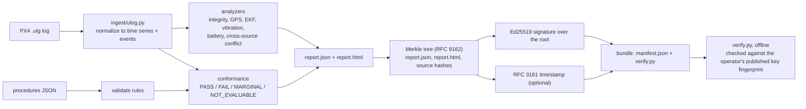

# AIR: Airspace Incident Record

AIR turns a PX4 drone flight log into an incident record that someone else can check: a
timeline, rule-based findings that cite their thresholds, procedure verdicts, and a signed,
tamper-evident bundle with an offline verifier. It is for people who have to explain a
crash or flyaway afterward, such as fleet operators, manufacturer support teams and
investigators.

[](https://github.com/jeheonlee11-create/air/actions/workflows/ci.yml)
Project site with a walkthrough of one public crash log: https://air.findanything.dev

## Why

After a drone incident, the record is usually a log file and someone's memory. Flight
log viewers plot the data, but a person still has to find the anomalies, check them
against the operator's written procedures, and write it up, and nothing shows later that
the write-up was not edited. AIR automates that first pass with explainable rules and
seals the result so any later change is detectable.

## How it works



1. `air/ingest/ulog.py` parses the log with pyulog and reduces it to named, unit-tagged
   time series and discrete events (arming, mode changes, failsafes, firmware messages).
   All PX4 topic and field-name differences between firmware versions are handled here.
   Altitude is kept as three separately labeled references: barometric, EKF height above
   its origin, and height above the home (launch) position.
2. `air/analyze/` runs deterministic analyzers. Each finding carries the evidence sample
   (value, timestamp, source channel) and the threshold with its basis, for example the
   retired ArduPilot LogAnalyzer limits or PX4's EKF innovation-ratio convention.
   `conflict.py` compares barometric altitude with GPS and with the EKF on a shared time
   grid, treating any sample older than 1 s as a gap rather than holding its last value.
3. `air/analyze/conformance.py` checks the flight against an operator's rules file. A value
   past the limit by less than the stated measurement tolerance is MARGINAL; a rule whose
   data is missing is NOT_EVALUABLE.
4. `air/evidence/bundle.py` writes `report.json` and `report.html`, builds an RFC 9162
   Merkle tree over both plus each source file's SHA-256, signs the root with Ed25519, and
   optionally gets an RFC 3161 timestamp token for it.
5. `verify.py` is a single file (stdlib plus `cryptography`) copied into every bundle. It
   recomputes the leaves, checks the signature, checks the signer against a fingerprint
   supplied from outside the bundle, and parses and checks the timestamp token.

## Design decisions and trade-offs

- **Fixed rules instead of a learned model.** Every finding can be traced to a threshold
  and its source, which matters when a record may be challenged. The cost is recall: the
  one crash signal evaluated so far misses most labeled crashes (see Results).
- **A Merkle tree instead of one hash over the bundle.** Each leaf has an inclusion proof,
  so one source file can be shown to belong to a record without handing over the others,
  and leaf/node domain separation rules out the classic second-preimage trick. The cost is
  more code than a single digest.
- **The key in the bundle is not trusted.** Anyone can re-sign an edited bundle with a new
  key, so the verifier only reports "signed by the expected key" when given the operator's
  published fingerprint, and exits 3 otherwise. This needs out-of-band key publication,
  which AIR does not provide.
- **Saying "can't tell" instead of guessing.** Missing data gives NOT_EVALUABLE, values
  within measurement tolerance give MARGINAL, and barometric altitude is never substituted
  for height above ground. Coverage numbers look worse, but no verdict claims more than the
  sensors support.

## Results

Unit and integration tests: 84 tests (`python -m pytest -q`). On a clean clone 79 run and
5 skip because they need fixture logs that are not committed (download command below).

Corpus evaluation, from [eval/EVALUATION.md](eval/EVALUATION.md). It was measured on
2026-07-28 at commit `cd67b86`, before the October 2026 changes to arm-cycle parsing,
altitude references, sample staleness and battery sag, and has not been re-run since.
Sample: seed 42, 120 logs drawn from the public PX4 Flight Review index, 100 processed
after a 20 MB size cap; labels are uploader ratings, not verified ground truth.

| Measure | Result |
|---|---|
| Logs parsed | 99 of 100 (the other was rejected with a clean error) |
| Uncaught pipeline errors | 0 of 100 |
| Identical analysis on repeat runs | 10 of 10 logs |
| Bundle verification | 5 of 5 unchanged bundles pass, 5 of 5 one-bit-tampered bundles fail |
| "Log ends in flight" (INT-TRUNC) vs crash labels, 66 labeled logs | 4 true positives, 0 false positives, 30 false negatives, 32 true negatives |
| Mean processing time | 0.18 s per log (laptop, single process) |

The crash signal is precise on this sample but has low recall: 4 of 34 labeled crashes
(12%). Most crashes keep logging until the vehicle is on the ground, and AIR does not yet
look for impact signatures. AIR should be read as an evidence tool, not a crash detector.

To reproduce: `curl -L -o fixtures/dbinfo.json https://cdn.logs.px4.io/dbinfo.json` (the
corpus index, about 30 MB), then `.venv/bin/python eval/harness.py`. It downloads about
750 MB of logs and deletes each one after processing.

## Limitations and next steps

- PX4 `.ulg` only. ArduPilot dataflash and DJI logs are not supported.
- Vibration and clipping are read from the first `vehicle_imu_status` instance only;
  redundant IMUs are compared only through PX4's own inconsistency channel.
- No signer identity: a fingerprint shows which key signed, not who controls it. There is
  no PKI, and the key is a file on disk (`~/.air/keys`), not in an HSM.
- The TSA chain is validated only with `--tsa-ca` and `openssl`; the default TSA is
  FreeTSA, a free service suited to development.
- Altitude rules use height above the launch point, not terrain-corrected AGL, and an EKF
  origin reset mid-flight is not handled. Measurement tolerances are documented defaults,
  not per-aircraft measurements.
- About half the thresholds are labeled heuristics rather than published limits.
- With several arm cycles, the analysis window spans all of them, including ground time.
- The signed record holds evidence samples and the source-file hash, not the raw
  telemetry; re-deriving a finding needs the original log.
- The evaluation is small, uses noisy labels, predates the latest fixes, and needs a
  fresh-seed rerun.

Strategy, audit, demo script and customer-discovery notes are in [docs/](docs/).

## Run it

```bash
git clone https://github.com/jeheonlee11-create/air.git && cd air
python3.11 -m venv .venv
.venv/bin/pip install -r requirements-dev.txt
.venv/bin/python -m pytest -q          # tests; fixture-based ones skip until the log is fetched
.venv/bin/ruff check .

# one public crash log from the PX4 corpus (20 MB)
mkdir -p fixtures
curl -L -o fixtures/75957ba9-f979-430d-a49c-8ef6e5ceec12.ulg \
  https://cdn.logs.px4.io/75957ba9-f979-430d-a49c-8ef6e5ceec12.ulg

.venv/bin/python -m air.cli investigate fixtures/75957ba9-f979-430d-a49c-8ef6e5ceec12.ulg \
  --procedures procedures/sample_ops_manual.json --no-timestamp
# prints findings, the bundle path and the signing key's fingerprint

# verify.py is copied into the bundle and needs only Python + cryptography
.venv/bin/python bundles/75957ba9-f979-430d-a49c-8ef6e5ceec12/verify.py \
  bundles/75957ba9-f979-430d-a49c-8ef6e5ceec12 --fingerprint <fingerprint printed above>
# exit 0: intact and signed by that key; 1: a check failed; 3: no fingerprint given
```

The signing key is created on first use in `$AIR_KEY_DIR`, or `~/.air/keys` if that is
not set; `--keys DIR` overrides both. Drop `--no-timestamp` to request an RFC 3161 token
from FreeTSA (this sends only a hash of the record). A local web demo runs with
`.venv/bin/python demo/app.py` at http://127.0.0.1:8420.

## How it was built

Built by Jeheon Lee with AI coding assistants (Claude Code, OpenAI Codex). I set the
direction and design, and verified behavior with the tests and evaluation above.

## License

MIT, see [LICENSE](LICENSE).
